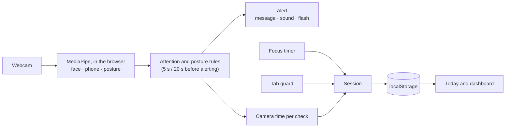

# Focus Guardian

A study timer that uses your webcam to notice when you look away, pick up your phone or
slouch, and tells you, without the video ever leaving your computer.

[](https://github.com/Noire-Phi/focus-guardian/actions/workflows/ci.yml)

<!-- Demo GIF: record a short session (start, look away, alert, dashboard), save it as
     docs/demo.gif and replace the line below with:  -->

> **Demo GIF:** coming soon.

**Live demo:** [noire-phi.github.io/focus-guardian](https://noire-phi.github.io/focus-guardian/)
(allow camera access when asked; it's only used in your browser).

## Features

- **Focus timer.** Pomodoro-style focus and break phases (25/5 by default, adjustable), with
  pause, reset and skip. It keeps exact time in a background tab and survives a page refresh.
- **Intentions and a distraction log.** Name what you're working on before you start; note
  each distraction in a keystroke (press <kbd>D</kbd>).
- **Tab guard.** Counts each time you switch away from the tab during a focus session, and
  for how long.
- **Looking-away check.** Estimates where your head is pointing and alerts you after 5 seconds
  of looking away, so a glance doesn't trigger it.
- **Study modes.** Screen, Book/Paper and Mixed. A short calibration records where your
  screen and your book are, so looking down at your notes counts as focused.
- **Phone detection.** Alerts when a phone is seen in three checks in a row.
- **Posture check.** Calibrate a good posture once; you're nudged after 20 seconds of
  slouching, leaning in or leaning to one side.
- **Focus score.** Each session gets a 0–100% score from time on task, phone use and
  posture ([how it's calculated](docs/FOCUS_SCORE.md)).
- **Dashboard.** Daily score, an 8-week trend, total study time and your most common
  distractions.
- **Settings.** Timer lengths, which checks run, sensitivity, alert sound, a screen flash
  instead of (or as well as) the sound, and light, dark or system theme. The timings above
  are for the default sensitivity; Low waits longer (10 s away), High less (3 s).
- **Accessible.** Usable by keyboard and screen reader, with every sound also shown on screen
  ([details](docs/ACCESSIBILITY.md)).

## Tech stack

| Area      | Choice                                                                                                |
| --------- | ----------------------------------------------------------------------------------------------------- |
| App       | React 19, TypeScript 6, Vite 8                                                                        |
| Detection | MediaPipe Tasks Vision: Face Landmarker, Object Detector (EfficientDet-Lite0), Pose Landmarker (lite) |
| Charts    | Chart.js 4                                                                                            |
| Storage   | `localStorage`, versioned, with backups of anything it can't read                                     |
| Testing   | Vitest and Testing Library (367 tests, about 97% line coverage)                                       |
| Quality   | ESLint, Prettier, and GitHub Actions on every push                                                    |
| Hosting   | GitHub Pages, deployed automatically when `main` passes its checks                                    |

No backend, no account, no analytics.

## How it works



1. **Detection.** About five times a second, the current camera frame goes through
   MediaPipe's Face Landmarker, which gives a head direction (turned left/right, tilted
   up/down). Every ~600 ms the frame also goes through either the object detector (looking
   for a phone) or the pose model (shoulders and head), taking turns so no single check is
   slow enough to make the page stutter.
2. **Judging.** Each check is compared with your calibration: on screen, on your book,
   moving between them, turned away, or no face. Being away has to last 5 seconds before an
   alert, and you have to be back for a second to clear it, so brief glances don't count.
3. **Scoring.** Each check stands for the time since the last one, added up as "watched",
   "on task", "phone" and "good posture". When the session ends, those totals and the time
   spent in other tabs give the focus score.
4. **Saving.** Finished sessions are saved in your browser and feed the Today panel and the
   dashboard.

The detection rules are explained step by step in [docs/ATTENTION.md](docs/ATTENTION.md). The
cost of running them, and how it stays low, is in [docs/PERFORMANCE.md](docs/PERFORMANCE.md).

## Privacy

- **The camera image never leaves your device.** Each frame is analysed in the browser and
  then discarded. No video or photos are recorded, saved or uploaded.
- **Only numbers are stored**, in your browser's `localStorage`: sessions, settings and
  calibration (head angles and posture measurements). Clearing your browser data deletes
  them.
- **The only network requests** are downloads of the MediaPipe runtime and models from
  jsDelivr and Google, the first time a session runs with the camera on. Nothing is sent
  back.
- **The camera is only on when you turn it on.** After a refresh it comes back on only if it
  was on in that tab and the browser already allows it, so you're never asked unexpectedly.

## Running it locally

You need [Node.js](https://nodejs.org/) 24 (the version is in `.nvmrc`) and a webcam.

```bash
git clone https://github.com/Noire-Phi/focus-guardian.git
cd focus-guardian
npm ci
npm run dev
```

Then open http://localhost:5173. Browsers only allow the camera on `localhost` or `https://`
pages, so use that address rather than your machine's IP. The app was developed and tested in
Chromium-based browsers (Chrome, Edge).

| Command                 | What it does                                  |
| ----------------------- | --------------------------------------------- |
| `npm run dev`           | Development server with hot reload            |
| `npm run build`         | Type-check and build to `dist/`               |
| `npm run preview`       | Serve the built app locally                   |
| `npm test`              | Run the tests once                            |
| `npm run test:coverage` | Tests with a coverage report (in `coverage/`) |
| `npm run lint`          | ESLint                                        |
| `npm run typecheck`     | TypeScript, without building                  |
| `npm run format`        | Format everything with Prettier               |

## Project structure

```
src/
  components/   UI: timer, camera card, calibration, settings, dashboard
  hooks/        State and side effects: timer, webcam, detection loop, attention, posture
  utils/        Pure logic with unit tests: timer rules, focus score, storage, scheduling
  types/        Shared types
docs/           Design notes: plan, attention, focus score, storage, design, accessibility, performance
```

The rules live in plain functions in `utils/` so they can be tested without a browser or a
camera; hooks connect them to React, and components only display.

## Future improvements

- **Run detection in a Web Worker.** MediaPipe currently runs on the page's main thread, so
  on a slow computer each check briefly freezes the page, and loading the models freezes it
  for about a second.
- **Tune the thresholds on real people.** The angle limits and sensitivity levels are
  reasonable defaults, not yet tested across different faces, glasses, cameras and lighting.
- **Export and import data**, so history survives clearing the browser or moving to another
  computer.
- **System notifications** when a phase ends while you're in another app, as an option.
- **Test with screen readers** (NVDA, VoiceOver). The accessibility work was checked in code
  and the browser, not with assistive technology.
- **Check Firefox and Safari.**
